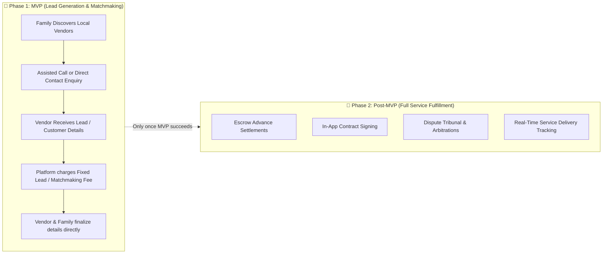
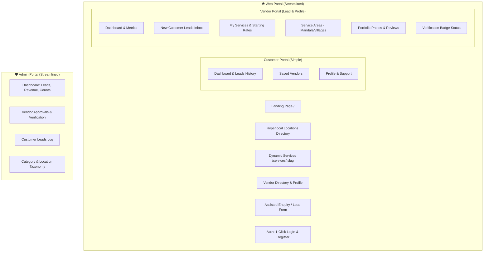

# Telangana Weddings — MVP Streamlining & Refinement Plan

> **Strategic Direction**: 
> Telangana Weddings is entering the market as a **Hyperlocal Matchmaking & Discovery Marketplace** (connecting rural & town wedding families directly with local master vendors and charging a simple connection/lead fee), rather than managing complex fulfillment, dispute arbitration, or full end-to-end service execution.

---

## 1. Core MVP Business Model vs Post-MVP Expansion

---

## 2. Web Application (`/web`) Page Audit & Recommendations

### A. Public Pages (`/web/src/app/(public)`)
| Route | Purpose | Recommendation | Rationale |
|---|---|---|---|
| `/` | Homepage (Act 1, 2, 3 storytelling + directory) | **KEEP (Core)** | Primary high-converting brand landing page. |
| `/about`, `/contact`, `/faq`, `/how-it-works` | Trust, contact & FAQs | **KEEP (Core)** | Essential trust signals for families and vendors. |
| `/become-a-vendor` | Vendor partner pitch & registration gateway | **KEEP (Core)** | High-priority conversion funnel for artisan vendors. |
| `/vendors` & `/vendors/[vendorSlug]` | Directory listing + Vendor profile detail | **KEEP (Core)** | Core product: where customers explore vendors, photos & reviews. |
| `/locations`, `/locations/[district]`, `.../[mandal]`, `.../[village]` | Hyperlocal SEO & village landing routes | **KEEP (Core)** | The unique competitive moat for rural tier-2/3 search. |
| `/services/[categorySlug]` | Dynamic category landing page | **KEEP (Core)** | Covers all 25 categories dynamically. |
| Static duplicate service pages: `/services/catering`, `/services/dj-sound`, `/services/band-melam-sannai`, etc. (18 hardcoded static directories) | Hardcoded service directory clones | ❌ **REMOVE / CONSOLIDATE** | Redundant. The single dynamic route `/services/[categorySlug]` already handles all categories with zero code duplication. |
| `/cancellation-policy`, `/terms`, `/privacy-policy` | Legal & compliance policies | **KEEP (Core)** | Required for legal compliance and payment gateways. |

---

### B. Customer Portal (`/web/src/app/customer`)
| Route | Purpose | Recommendation | Rationale |
|---|---|---|---|
| `/customer/dashboard` | Overview of requests, saved vendors & profile | **KEEP (Core)** | Central hub for family account. |
| `/customer/enquiries` & `/[enquiryId]` | Assisted calls and quotation lead requests | **KEEP (Core)** | Core matchmaking mechanism: families track who they contacted. |
| `/customer/saved-vendors` | Bookmarked vendors shortlist | **KEEP (Core)** | Crucial for family decision-making before calling. |
| `/customer/profile` & `/customer/settings` | Account details & contact preferences | **KEEP (Core)** | Basic account management. |
| `/customer/support` | Telugu phone & WhatsApp helpline | **KEEP (Core)** | Critical for non-tech-savvy village families. |
| `/customer/notifications` | Alerts when a vendor contacts or updates | **KEEP (Core)** | Informs customers when vendors respond. |
| `/customer/my-weddings`, `/my-weddings/create`, `/[eventId]` | Heavy multi-event project management | ❌ **REMOVE for MVP** | Overkill for MVP. Families just want to find vendors for their wedding date, not manage a Jira-style event tool. |
| `/customer/bookings` & `/[bookingId]` | Formal service contract execution & token tracking | ❌ **REMOVE / MERGE into Enquiries** | In Phase 1, booking confirmation is handled directly between customer and vendor after the match. |
| `/customer/quotations` & `/[quotationId]` | Separate formal quotation approval workflow | ❌ **MERGE into Enquiries** | Redundant separation. Quotes can be viewed directly within the Enquiry details. |
| `/customer/payments` | Full escrow balance payment history | ❌ **REMOVE for MVP** | In Phase 1, the customer doesn't pay for the entire wedding via the platform; only matchmaking/lead fees exist. |

---

### C. Vendor Partner Portal (`/web/src/app/vendor`)
| Route | Purpose | Recommendation | Rationale |
|---|---|---|---|
| `/vendor/dashboard` | Overview of leads, views, and active inquiries | **KEEP (Core)** | Vendor's main operations control room. |
| `/vendor/enquiries` & `/[enquiryId]` | Customer leads (name, phone, village, wedding date) | **KEEP (Core)** | The heart of the matchmaking business model. |
| `/vendor/services` & `/[serviceId]/edit`, `/create` | Managing services & price cards | **KEEP (Core)** | Vendors showcase what they offer and starting prices. |
| `/vendor/service-areas` | Mandals and villages where vendor can travel | **KEEP (Core)** | Essential for hyperlocal matching algorithms. |
| `/vendor/portfolio` | Photo gallery of past weddings | **KEEP (Core)** | Builds authentic visual trust. |
| `/vendor/reviews` | Customer feedback and star ratings | **KEEP (Core)** | Social proof for rural vendors. |
| `/vendor/verification` | Field verification trust badge status | **KEEP (Core)** | Differentiates trusted locals from random listings. |
| `/vendor/profile` & `/vendor/settings` | Business phone, UPI ID, profile info | **KEEP (Core)** | Basic profile management. |
| `/vendor/support` | Coordinator helpline | **KEEP (Core)** | Support for vendors. |
| `/vendor/notifications` | Lead alerts | **KEEP (Core)** | Instant notification when a customer expresses interest. |
| `/vendor/register` | Self-serve vendor onboarding flow | **KEEP (Core)** | Allows new vendors to sign up. |
| `/vendor/bookings` & `/[bookingId]` | Full service delivery tracking | ❌ **REMOVE for MVP** | We are not managing full fulfillment during Phase 1. |
| `/vendor/packages` | Duplicate package editor | ❌ **CONSOLIDATE into `/vendor/services`** | Redundant duplicate of services. |
| `/vendor/quotations` & `/create` | Formal multi-item quotation generation | ❌ **SIMPLIFY / CONSOLIDATE** | Vendors can provide a direct quote on the enquiry or talk over phone. |
| `/vendor/availability` | Complex full-calendar slot blocking | ❌ **SIMPLIFY for MVP** | Most rural vendors manage calendars via phone; a simple "Available/Busy" toggle per date is sufficient. |
| `/vendor/commissions` & `/vendor/settlements` | Multi-tier platform commission calculation & payout | ❌ **REMOVE / REPLACE with simple Lead Invoices** | In MVP, we only track the simple matchmaking fee (e.g. ₹99 per lead or monthly subscription), not complex gross margins. |

---

## 3. Admin Portal (`/admin`) Page Audit & Recommendations

| Route | Purpose | Recommendation | Rationale |
|---|---|---|---|
| `/admin/dashboard` | Total vendors, active leads, platform revenue | **KEEP (Core)** | Primary executive view. |
| `/admin/vendors` & `/[vendorId]` | Vendor directory, approval & status toggle | **KEEP (Core)** | Core admin responsibility: onboarding & checking vendors. |
| `/admin/vendor-verification` | Physical / Field verification approval desk | **KEEP (Core)** | Key trust factor: approving verified badges. |
| `/admin/enquiries` | Matchmaking log of all customer-vendor connections | **KEEP (Core)** | Tracking lead delivery and customer satisfaction. |
| `/admin/categories` & `/subcategories` | Master taxonomy of 25+ wedding categories | **KEEP (Core)** | System foundation for matching. |
| `/admin/locations` | Telangana districts, mandals, villages hierarchy | **KEEP (Core)** | Hyperlocal geographic mapping. |
| `/admin/customers` | Customer directory | **KEEP (Core)** | Basic CRM to view customer phone numbers & requests. |
| `/admin/settings` | Platform contact info, lead fee amounts | **KEEP (Core)** | Operational control. |
| `/admin/disputes` | Formal dispute resolution & arbitration court | ❌ **REMOVE for MVP** | No escrow or fulfillment management $\implies$ no service fulfillment disputes on platform. |
| `/admin/commissions` | Complex multi-tier commission rule engine | ❌ **REMOVE for MVP** | Replace with simple lead fee or subscription model. |
| `/admin/bookings` | End-to-end booking fulfillment monitoring | ❌ **REMOVE for MVP** | Handled directly between parties in Phase 1. |
| `/admin/payments` | Complex multi-party payouts & payouts ledger | ❌ **SIMPLIFY to "Matchmaking Fee Collections"** | Only need to record vendor lead credits or subscription payments. |
| `/admin/reports` | Deep business intelligence & tax reports | ❌ **DEFER for MVP** | Basic metrics on the dashboard are sufficient for MVP. |

---

## 4. Proposed Clean MVP Sitemap

---

## 5. Execution Status & Next Steps

### ✅ Step 1 & 2: Pages Cleaned & Streamlined (COMPLETED)
- **Web App**:
  - Consolidated 18 redundant static service folders into dynamic `/services/[categorySlug]`.
  - Archived out-of-scope customer modules (`bookings`, `quotations`, `my-weddings`, `payments`).
  - Archived out-of-scope vendor modules (`bookings`, `quotations`, `commissions`, `settlements`, `packages`, `availability`).
  - Updated `CUSTOMER_NAV` and `VENDOR_NAV` with clean MVP lead generation links.
  - Replaced dead links in dashboards and enquiry detail screens with direct contact actions.
- **Admin App**:
  - Archived non-MVP modules (`bookings`, `commissions`, `disputes`).
  - Updated Admin navigation to focus on Vendors, Verification, Customers, Categories, Locations, Enquiries, Subscriptions/Fees, Reports, and Settings.
  - Repaired module dependencies in `admin/node_modules`.
- **Archives**: All removed code is safely preserved under `docs/_archive/` for Phase 2 re-activation.
- **Compilation Check**: Both `web` and `admin` pass `tsc --noEmit` with **0 errors**.

---

## 6. Next Phase: Backend Services Architecture (Ready to Plan)

Based on the MVP lead matchmaking model, our backend will focus on these essential domain models:

1. **Identity & Auth**:
   - `User` (Customer, Vendor, Admin) with phone/OTP login.
2. **Master Catalog & Geography**:
   - `Category` & `Subcategory` (25+ wedding services).
   - `Location` (Telangana Districts, Mandals, and Villages).
3. **Vendor Profiles**:
   - `VendorProfile` (Business details, verified badge status, starting rates, portfolio photos).
   - `VendorServiceArea` (Coverage by district/mandal/village).
   - `VendorServiceItem` (Specific services and pricing cards).
4. **Lead & Matchmaking Engine**:
   - `Enquiry / Lead` (Customer requirements, event date, village, budget).
   - `LeadAssignment` (Matched vendors who received the lead).
5. **Monetization & Billing**:
   - `VendorSubscription / LeadCredit` (Listing tiers or pay-per-lead unlocks).
   - `PaymentTransaction` (UPI / Razorpay transaction receipts).
