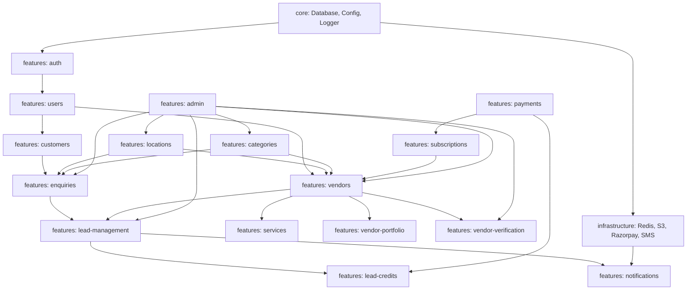
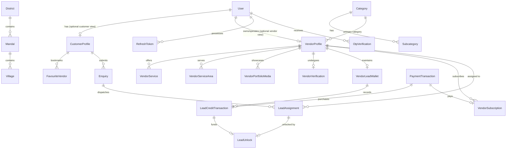
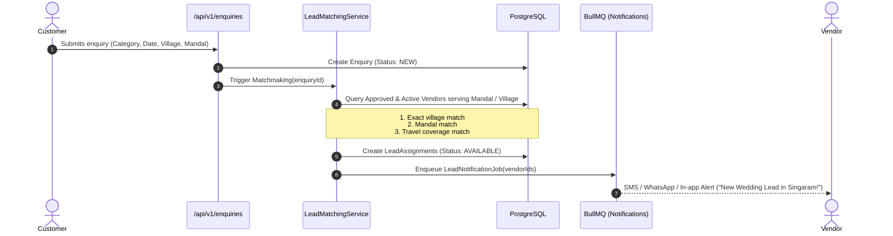
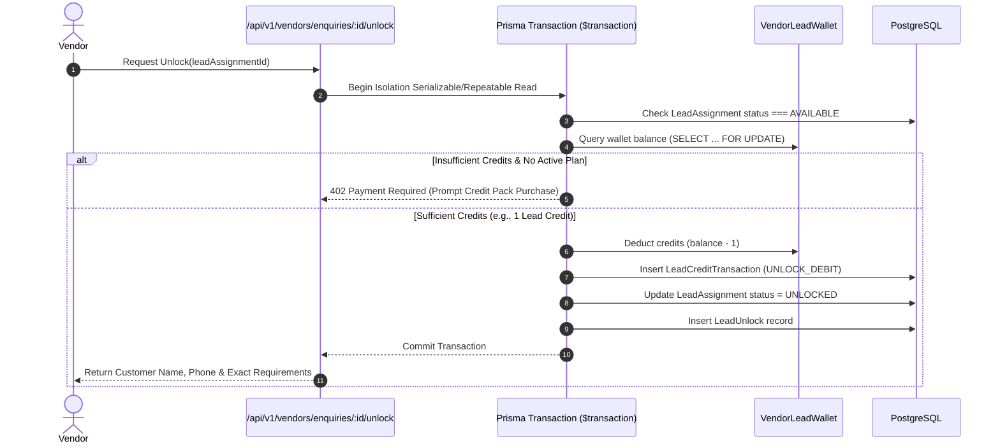

# Telangana Weddings — Backend Architecture Audit & Master Blueprint

> **Reference Document**: [docs/backend/BACKEND_MASTER_PROMPT.md](file:///c:/Users/Signi/Documents/WorkSpace/WebApplications/telangana-weddings-starter/docs/backend/BACKEND_MASTER_PROMPT.md)  
> **Status**: Comprehensive Repository Audit & Architectural Response (Phase 0)

---

## 1. Existing Repository Structure

```text
telangana-weddings-starter/
├── web/                             # Next.js 16 Customer & Vendor Web Application (25 clean routes)
├── admin/                           # Next.js 16 SuperAdmin & Operations Dashboard (12 clean routes)
├── app/                             # React Native / Expo Mobile App Directory (Ready for setup)
├── backend/                         # Central Backend Directory (Starter state: minimal package.json + index.ts)
├── docs/                            # Architectural specifications & audits
│   ├── MVP_PLAN.md                  # Frontend & Product Scope Definition
│   └── backend/
│       ├── BACKEND_MASTER_PROMPT.md # Master Prompt
│       └── BACKEND_AUDIT.md         # This Document
└── .agents/                         # UI/UX & Design Skill intelligence
```

---

## 2. Current Backend Technology & Architecture

| Attribute | Current State | Target MVP State |
| :--- | :--- | :--- |
| **Framework** | None (bare `index.ts` placeholder) | **NestJS 11 LTS** (Modular Monolith) |
| **Language** | TypeScript | Strict TypeScript |
| **Database** | None | **PostgreSQL** + **Prisma ORM** |
| **Architecture** | Uninitialized | **Feature-Based (Vertical Slice) Architecture** |
| **Auth** | Mock cookie session on client | **Phone OTP + JWT + Rotating Refresh Tokens** (Argon2id) |
| **Lead Engine** | Frontend Zustand store (`useAppStore.ts`) | **Server-side Matchmaking Engine + Atomic Wallet** |
| **Storage** | Public static files in `/public` | **AWS S3 Presigned URLs + CloudFront** |
| **Jobs / Queue** | Synchronous client timeouts | **BullMQ + Redis** |
| **Payment Gateway**| Mock dialogs | **Razorpay Integration** (Order, Verification, Webhooks) |

---

## 3. Existing Modules & Functionality Across the Monorepo

### A. Implemented & Operational (Frontend Fronting the Monorepo):
1. **Public Web Experience (`web`)**:
   - Act 1, 2, 3 storytelling landing page with Telugu / English language toggle.
   - Dynamic wedding services category explorer (`/services/[categorySlug]`).
   - Hyperlocal location hierarchy browsing (`/locations/[district]/[mandal]/[village]`).
   - Vendor directory and detailed vendor portfolio showcase (`/vendors/[vendorSlug]`).
   - Assisted booking lead request modal (`AssistedBookingModal.tsx`).
2. **Customer Portal (`web`)**:
   - Customer authentication via phone/OTP (`/auth/login`).
   - Enquiries and lead status tracker (`/customer/enquiries`).
   - Saved/bookmarked vendors (`/customer/saved-vendors`).
   - Profile and notification settings.
3. **Vendor Partner Portal (`web`)**:
   - Vendor dashboard with lead counts and profile completeness (`/vendor/dashboard`).
   - Inbound customer leads inbox (`/vendor/enquiries`).
   - Service cards and price packages configuration (`/vendor/services`).
   - Service coverage areas by mandals and villages (`/vendor/service-areas`).
   - Field verification status desk (`/vendor/verification`).
   - Portfolio image gallery management (`/vendor/portfolio`).
4. **Admin Dashboard (`admin`)**:
   - Vendor approval & physical verification review desk (`/vendor-verification`, `/vendors`).
   - Master taxonomy for 25+ categories and subcategories (`/categories`, `/subcategories`).
   - Master geography for Telangana Districts, Mandals & Villages (`/locations`).
   - Platform lead log and manual enquiry dispatch desk (`/enquiries`).
   - Subscription plans and fee transaction monitor (`/payments`).

---

## 4. Missing Backend Functionality (To Be Built)

1. **Production NestJS Foundation**:
   - Global validation pipes (`class-validator`, `class-transformer`), centralized exception filters, Pino request logging, and Swagger/OpenAPI documentation.
2. **Identity & Auth Module**:
   - SMS OTP dispatch, verification, JWT signing, refresh token rotation, and RBAC guards (`CUSTOMER`, `VENDOR_OWNER`, `VENDOR_STAFF`, `ADMIN`, `SUPER_ADMIN`).
3. **Database Schema & Prisma Migrations**:
   - Fully normalized PostgreSQL schema modeling users, vendors, services, locations, categories, enquiries, lead assignments, wallets, and subscriptions.
4. **Lead Matchmaking Engine**:
   - Geographic matching logic (Village $\to$ Mandal $\to$ District coverage) with configurable assignment rules and duplicate prevention.
5. **Lead Unlock & Atomic Credit Ledger**:
   - Concurrency-safe atomic lead unlock mechanism preventing double charges and securing customer contact details behind the paywall.
6. **Payment & Billing Webhooks**:
   - Razorpay order creation, payment signature verification, and idempotent webhook handlers for credit pack purchases and vendor subscriptions.
7. **Cloud Infrastructure & Media**:
   - S3 presigned URL generation for secure, direct-to-cloud portfolio and verification document uploads.

---

## 5. Recommended Feature-Based Folder Structure

```text
backend/
├── prisma/
│   ├── schema.prisma                  # Normalized PostgreSQL Schema
│   ├── migrations/                    # Versioned Migration Scripts
│   └── seed.ts                        # Seed data (Categories & Telangana Locations)
│
├── src/
│   ├── main.ts                        # Application Bootstrap & Swagger
│   ├── app.module.ts                  # Root Module
│   │
│   ├── core/                          # Cross-Cutting Infrastructure
│   │   ├── database/                  # PrismaService & Transaction helpers
│   │   ├── config/                    # Environment validation (Zod/Joi)
│   │   ├── logger/                    # Structured Pino logger
│   │   └── health/                    # Terminus health checks
│   │
│   ├── common/                        # Shared Utilities
│   │   ├── decorators/                # @CurrentUser(), @Roles(), @Public()
│   │   ├── guards/                    # JwtAuthGuard, RolesGuard, OwnershipGuard
│   │   ├── filters/                   # GlobalExceptionFilter
│   │   ├── interceptors/              # TransformResponseInterceptor, LoggingInterceptor
│   │   └── pipes/                     # ZodValidationPipe / Custom Pipes
│   │
│   ├── infrastructure/                # External Services
│   │   ├── redis/                     # Redis Client Provider
│   │   ├── queues/                    # BullMQ Queue Definitions
│   │   ├── storage/                   # AWS S3 Presigned URL Service
│   │   ├── sms/                       # SMS Provider Adapter (Twilio / MSG91)
│   │   └── payment-gateway/           # Razorpay Adapter
│   │
│   └── features/                      # Business Feature Slices
│       ├── auth/                      # Phone OTP, JWT, Session Revocation
│       ├── users/                     # Shared identity & user profiles
│       ├── customers/                 # Customer profiles & preferences
│       ├── vendors/                   # Vendor business profiles & onboarding
│       ├── categories/                # Taxonomy (Categories & Subcategories)
│       ├── locations/                 # Telangana Hierarchy (Districts, Mandals, Villages)
│       ├── services/                  # Vendor service cards & starting rates
│       ├── vendor-portfolio/          # Portfolio photos & video links
│       ├── vendor-verification/       # Field verification & document approvals
│       ├── vendor-discovery/          # Hyperlocal search & filtering
│       ├── enquiries/                 # Customer enquiry submission & lifecycle
│       ├── lead-management/           # Matching algorithm & vendor assignment
│       ├── lead-credits/              # Vendor wallet, credit packs & atomic ledger
│       ├── subscriptions/             # Listing tiers & monthly subscriptions
│       ├── payments/                  # Razorpay checkout & webhook processing
│       ├── favourites/                # Saved vendors
│       ├── reviews/                   # Customer reviews & ratings
│       ├── notifications/             # In-app, SMS & async notification dispatch
│       ├── uploads/                   # Media upload endpoints
│       ├── support/                   # Assisted enquiries & helpline calls
│       ├── admin/                     # Administrative management & audit logs
│       └── analytics/                 # Executive marketplace reporting
│
├── test/                              # Unit, Integration & E2E Suites
├── Dockerfile                         # Production Multi-Stage Build
├── docker-compose.yml                 # Local PostgreSQL + Redis Environment
└── package.json
```

---

## 6. Feature Responsibility Matrix

| Feature Module | Primary Responsibility | Key External Dependencies |
| :--- | :--- | :--- |
| **`auth`** | Issues phone OTPs, verifies sessions, creates JWTs, rotates refresh tokens. | SMS Gateway, `users` |
| **`users`** | Central identity record, credential storage, role management. | Prisma |
| **`customers`** | Customer profile, contact preferences, saved vendor lists. | `users`, `locations` |
| **`vendors`** | Vendor business profiles, staff management, verification status. | `users`, `locations`, `categories` |
| **`categories`** | Master catalogue of 25+ wedding categories and subcategories (Telugu & English). | Prisma (Read-heavy, Redis cached) |
| **`locations`** | Districts, Mandals, Villages taxonomy. | Prisma (Read-heavy, Redis cached) |
| **`services`** | Specific service offerings and starting price cards created by vendors. | `vendors`, `categories` |
| **`vendor-portfolio`**| Portfolio images/videos metadata. | AWS S3 |
| **`vendor-verification`**| Submission and admin approval of Aadhaar/GST/Field inspection badges. | `vendors`, S3, `notifications` |
| **`vendor-discovery`**| High-performance search, category filtering, and location matching for families. | `vendors`, `services`, `locations` |
| **`enquiries`** | Intake of customer requirements, dates, locations, and assisted phone requests. | `customers`, `locations`, `categories` |
| **`lead-management`** | Runs matching rules to assign enquiries to eligible vendors; tracks unlock states. | `enquiries`, `vendors`, `lead-credits` |
| **`lead-credits`** | Manages vendor credit balances, atomic deduction upon lead unlock, ledger history. | Prisma (PostgreSQL Transactions) |
| **`subscriptions`** | Manages recurring vendor monthly listing tiers. | `payments`, `vendors` |
| **`payments`** | Integrates Razorpay for credit packs and subscriptions; verifies webhooks. | Razorpay, `lead-credits`, `subscriptions` |
| **`favourites`** | Manages customer bookmarks for vendors. | `customers`, `vendors` |
| **`reviews`** | Stores authentic customer reviews and star ratings. | `customers`, `vendors` |
| **`notifications`** | Dispatches SMS alerts and in-app notifications on lead events. | BullMQ, Redis, SMS Provider |
| **`uploads`** | Generates presigned URLs for client-to-S3 direct uploads. | AWS S3 Client |
| **`support`** | Assisted inquiry intake for non-tech-savvy village families. | `enquiries`, `notifications` |
| **`admin`** | Operational control: vendor approvals, verification, settings, manual assignments. | All features |
| **`analytics`** | High-level metrics: lead volumes, active vendors, platform revenue. | Prisma |

---

## 7. Feature Dependency Map



---

## 8. Database Entity Inventory & ER Diagram

> **Multi-Role User Architecture (`roles: UserRole[]`)**:  
> In local Telangana communities, a wedding vendor (e.g. a decorator, caterer, or mandap owner) will also organize weddings in their family and need to discover other vendors as a customer.  
> Therefore, `User.roles` is an array: `roles: UserRole[]` (e.g., `["CUSTOMER", "VENDOR_OWNER"]`).  
> - A user can have **both a `CustomerProfile` and a `VendorProfile`** attached to the same phone number.
> - When using the **Customer Android App**, they interact through their `CustomerProfile`.
> - When logging into the **Vendor Portal (`web`)**, they manage their business through their `VendorProfile`.
> - The same phone number is never duplicated.



### Key Models Defined in Prisma:
1. **`User`**: `id`, `phone`, `email`, `roles` (`UserRole[]`, e.g. `["CUSTOMER", "VENDOR_OWNER"]`), `status`, `createdAt`, `updatedAt`.
2. **`OtpVerification`**: `id`, `phone`, `otpHash`, `attempts`, `expiresAt`, `verifiedAt`.
3. **`CustomerProfile`**: `id`, `userId` (unique), `name`, `preferredLanguage`, `districtId`, `mandalId`, `villageId`.
4. **`VendorProfile`**: `id`, `userId` (owner), `businessName`, `slug`, `categoryId`, `description`, `phone`, `whatsapp`, `status` (APPROVED, etc.), `verificationStatus` (VERIFIED, etc.), `startingPricePaise`.
5. **`VendorServiceArea`**: `id`, `vendorId`, `districtId`, `mandalId`, `villageId`.
6. **`Category` & `Subcategory`**: `id`, `slug`, `nameEn`, `nameTe`, `iconUrl`, `sortOrder`, `isActive`.
7. **`District`, `Mandal`, `Village`**: Normalised geographical tables with parent FKs.
8. **`Enquiry`**: `id`, `customerId`, `categorySlug`, `eventDate`, `districtId`, `mandalId`, `villageName`, `source` (WEBSITE, ANDROID_APP, PHONE_ASSISTED), `budgetPaise`, `status`.
9. **`LeadAssignment`**: `id`, `enquiryId`, `vendorId`, `status` (AVAILABLE, UNLOCKED, EXPIRED), `assignedAt`.
10. **`LeadUnlock`**: `id`, `assignmentId`, `vendorId`, `creditsDeducted`, `unlockedAt`.
11. **`VendorLeadWallet`**: `id`, `vendorId`, `balanceCredits`, `updatedAt`, `version` (for optimistic concurrency).
12. **`LeadCreditTransaction`**: `id`, `walletId`, `amount`, `type` (PURCHASE, UNLOCK_DEBIT, REFUND_CREDIT), `referenceId`.
13. **`PaymentTransaction`**: `id`, `vendorId`, `gateway` (RAZORPAY), `gatewayOrderId`, `gatewayPaymentId`, `amountPaise`, `status`, `receiptNumber`.

---

## 9. Lead Matching Engine Workflow



---

## 10. Atomic Lead Unlock & Credit Workflow



---

## 11. Security Considerations

1. **Zero Customer PII Leakage**: Customer phone numbers and wedding venue locations are strictly masked until `LeadAssignment.status === 'UNLOCKED'` by that specific vendor.
2. **Server-Side Financial Authority**: Client apps cannot pass credit amounts or payment confirmations. Only server-side Razorpay webhook signature validation can increment wallet credits or activate subscriptions.
3. **Double-Spend & Concurrency Protection**: Atomic Prisma transactions with database row locking (`FOR UPDATE`) and unique constraints on `LeadUnlock(assignmentId, vendorId)` ensure a vendor is never charged twice for the same lead.
4. **Brute Force & Abuse Prevention**:
   - Phone OTP rate limiting (max 3 attempts per OTP, 60s resend cooldown, max 5 OTP requests per phone per hour).
   - Global NestJS Throttler for public endpoints.

---

## 12. Implementation Phases & Approvals

### Phase 0: Architecture & Documentation (THIS PHASE - COMPLETED)
- [x] Comprehensive repository audit.
- [x] Production master blueprint created at `docs/backend/BACKEND_MASTER_PROMPT.md`.
- [x] Feature responsibility matrix, dependency map & ER diagram created at `docs/backend/BACKEND_AUDIT.md`.

### Phase 1: Foundation Setup (NEXT)
- Initialize NestJS 11 inside `backend/`.
- Configure Prisma ORM with PostgreSQL connection.
- Setup global validation pipes, Pino logging, and Swagger OpenAPI at `/api/v1/docs`.
- Create Docker Compose with PostgreSQL 16 & Redis 7.

### Phase 2: Identity & Access
- Implement phone OTP flow, JWT access & refresh token rotation.
- Role-based guards (`CUSTOMER`, `VENDOR_OWNER`, `ADMIN`).

### Phase 3: Taxonomy & Vendor Management
- Seed Telangana Districts, Mandals, and 25+ wedding categories.
- Vendor registration, profile management, and service area configuration.

### Phase 4: Discovery & Lead Matchmaking
- Public vendor directory search and category filtering.
- Customer enquiry creation and the geographic Lead Matching engine.

### Phase 5: Lead Monetization & Razorpay
- Vendor lead credits wallet, atomic lead unlock, and Razorpay payment webhooks.

### Phase 6: Admin Operations & Production Readiness
- Admin approval desks, verification badging, and automated test suite.

---

### Decisions Requiring Product Owner Approval:
1. **Lead Pricing Default**: Shall the default cost to unlock a lead be **1 credit** (e.g., ₹99 per credit package), or should categories have tiered credit costs (e.g., Kalyana Mandapam = 3 credits, Sannai Melam = 1 credit)?
2. **Multi-Vendor Assignment Limit**: When a customer submits an enquiry, what is the maximum number of vendors that can receive the lead? (Recommended: **3 to 5 vendors** max to prevent spamming families).
3. **Database Environment**: Confirm if you want a local Docker Compose PostgreSQL instance for development or a cloud RDS/Supabase connection string.

