# Telangana Weddings — Phase 0: Customer Android Application Audit Report & Implementation Plan

> **Role**: Senior React Native Architect, Mobile Product Engineer & Technical Lead  
> **Target**: Official Customer Android Application for **Telangana Weddings**  
> **Master Reference**: [docs/mobile/MOBILE_MASTER_PROMPT.md](file:///c:/Users/Signi/Documents/WorkSpace/WebApplications/telangana-weddings-starter/docs/mobile/MOBILE_MASTER_PROMPT.md)  
> **Status**: **Phase 0 Audit Complete — Awaiting Product Owner Approval before coding**

---

## 1. Existing Repository Structure & Mobile State

```text
telangana-weddings-starter/
├── web/                       # Next.js 16 Web Application (Customer & Vendor Portal, 25 routes, clean lint & build)
├── admin/                     # Next.js 16 SuperAdmin Dashboard (12 routes, clean lint & build)
├── backend/                   # NestJS Central REST API (/api/v1, PostgreSQL, Prisma ORM, Redis)
├── app/                       # Target Customer Android application directory (Currently empty with .gitignore)
├── docs/                      # Master architecture specifications
│   ├── MVP_PLAN.md            # Streamlined MVP scope documentation
│   ├── backend/               # Backend architecture & database blueprint
│   └── mobile/                # Mobile master prompt & audit docs
└── .agents/                   # UI/UX design intelligence skills
```

### Audit Findings:
- **Mobile Codebase**: The `app/` folder is an uninitialized, clean slate. No conflicting packages or legacy mobile code exists.
- **Backend Coupling**: The mobile application will be a pure consumer of the central **NestJS REST API (`/api/v1`)**.
- **Shared Domain Knowledge**:
  - `web/src/types/index.ts` contains battle-tested TypeScript interfaces (`Category`, `Vendor`, `LocationHierarchy`, `AssistedEnquiry`, `MockWebAccount`).
  - `web/src/data/index.ts` contains the full 25+ wedding category taxonomy and complete rural Telangana location hierarchy (Narayanpet & Mahabubnagar districts, mandals, and villages in both Telugu and English).

---

## 2. Unified Identity & RBAC Integration

In strict adherence to Section 5 of the Master Prompt and multi-role requirements:
- **Roles Stored as an Array**: A single user can hold multiple roles simultaneously, e.g.:
  ```typescript
  roles: ["CUSTOMER", "VENDOR_OWNER"]
  ```
  *(A wedding vendor in a village may also be planning a family wedding as a customer).*
- **Identity & Profile Architecture**:
  ```text
  User (id, phone, email, status, roles: UserRole[])
   ├── CustomerProfile (name, preferredLanguage, districtId, mandalId, villageId)
   └── VendorProfile / VendorMemberships (businessName, category, serviceAreas...)
  ```
- **Context-Aware Behavior in Customer Android App**:
  - The mobile app detects `user.roles.includes("CUSTOMER")`.
  - If a user with `["VENDOR_OWNER"]` logs into the customer app, the backend automatically initializes or associates their `CustomerProfile` and appends `"CUSTOMER"` to their `roles` array (`["VENDOR_OWNER", "CUSTOMER"]`).
  - The customer Android app operates in **Customer Mode** for discovering vendors, saving favourites, and tracking family enquiries.
  - Their vendor credentials and portal access on the web remain completely intact and linked to the same phone number.
  - Token storage: Hardware-backed **Expo SecureStore** (`tw_access_token`, `tw_refresh_token`). **No plain AsyncStorage**.

---

## 3. Recommended Feature-Based Mobile Architecture

We organize the mobile app by business domain slices inside `app/`:

```text
app/                                   # Customer Android Mobile Workspace
├── app/                               # Expo Router File-Based Routes
│   ├── _layout.tsx                    # Root Layout (QueryClientProvider, AuthProvider, LanguageProvider)
│   ├── index.tsx                      # Initial route splash & redirect
│   │
│   ├── (public)/                      # Unauthenticated Onboarding & Pickers
│   │   ├── welcome.tsx                # Cultural Greeting & Language Select
│   │   └── location-modal.tsx         # District/Mandal/Village Selector Sheet
│   │
│   ├── (auth)/                        # Phone OTP Authentication
│   │   ├── phone.tsx                  # Enter Phone Number
│   │   ├── verify-otp.tsx             # 6-Digit OTP Input with Cooldown
│   │   └── profile-setup.tsx          # Name & Village Input (First-time users)
│   │
│   ├── (tabs)/                        # 5 Primary Bottom Tabs
│   │   ├── _layout.tsx                # Cultural Bottom Tab Bar (Maroon & Zari Gold)
│   │   ├── index.tsx                  # Tab 1: Home (Hyperlocal Wedding Discovery)
│   │   ├── explore.tsx                # Tab 2: Categories & Search
│   │   ├── enquiries.tsx              # Tab 3: My Enquiries & Lead Status
│   │   ├── saved.tsx                  # Tab 4: Saved / Bookmarked Vendors
│   │   └── profile.tsx                # Tab 5: Account, Language & Support
│   │
│   ├── category/
│   │   └── [categorySlug].tsx         # Dynamic Category Vendor Listing
│   │
│   ├── vendor/
│   │   └── [vendorSlug].tsx           # Detailed Vendor Profile & Portfolio Viewer
│   │
│   ├── enquiry/
│   │   ├── create.tsx                 # Fast Enquiry Submission Form
│   │   └── [enquiryId].tsx            # Enquiry Details & Status View
│   │
│   └── support/
│       └── callback.tsx               # One-Tap Assisted Phone Call Request
│
├── src/
│   ├── core/                          # Cross-Cutting Infrastructure
│   │   ├── api/                       # Axios Client with auto JWT injection & Refresh Token interceptor
│   │   ├── query/                     # TanStack Query Client configuration
│   │   ├── storage/                   # SecureStore wrapper for tokens & MMKV/Async for preferences
│   │   └── config/                    # API base URL & runtime environment variables
│   │
│   ├── common/                        # Reusable Native Design System Components
│   │   ├── components/                # Button, Input, Card, Header, Badge, Skeleton, EmptyState, BottomSheet
│   │   ├── theme/                     # Colors, Spacing, Elevation tokens
│   │   └── utils/                     # Currency format (₹), Date format, Phone validator
│   │
│   ├── features/                      # Feature Slices (Components, Hooks, DTOs)
│   │   ├── auth/                      # useAuth, useSendOtp, useVerifyOtp
│   │   ├── home/                      # HeroBanner, SpotlightCategories, PopularVendors, TrustBar
│   │   ├── categories/                # CategoryGrid, SubcategoryFilterChips
│   │   ├── locations/                 # LocationPickerSheet, useLocationStore
│   │   ├── vendor-discovery/          # VendorCard, FilterModal, SearchBar
│   │   ├── vendor-profile/            # PortfolioCarousel, StartingRatesCard, CallVendorButton
│   │   ├── enquiries/                 # EnquiryForm, useSubmitEnquiry, EnquiryCard
│   │   ├── favourites/                # useFavourites, BookmarkToggle
│   │   └── support/                   # AssistedCallModal, HelplineCard
│   │
│   └── localization/                  # Telugu & English Dictionaries
│       ├── te.json                    # Telugu Strings (Culturally verified)
│       ├── en.json                    # English Strings
│       └── i18n.ts                    # Language Provider & useTranslation Hook
│
├── assets/
│   ├── images/                        # Logos, Kalash & Mandala illustrations
│   └── fonts/                         # Sora, Inter, Noto Serif Telugu, Noto Sans Telugu
│
├── app.json                           # Expo Android Package & Permission Config
├── eas.json                           # EAS Build (APK & AAB) profiles
└── tsconfig.json                      # Strict TypeScript
```

---

## 4. Complete Screen Inventory & User Journeys

| # | Screen | Route | Key Features & Responsibilities |
|---|---|---|---|
| 1 | **Welcome / Language** | `(public)/welcome` | Traditional Telugu greeting; 1-tap Telugu or English language toggle; skip or continue. |
| 2 | **Location Picker** | `(public)/location-modal` | Dependent dropdowns: District $\to$ Mandal $\to$ Village (defaults to Narayanpet / Mahabubnagar). |
| 3 | **Home Feed** | `(tabs)/index` | Location header, search bar, wedding category grid, verified vendor badges, assisted call CTA. |
| 4 | **Explore Categories** | `(tabs)/explore` | Full 25+ categories listing with search and subcategory chips. |
| 5 | **Category Vendors** | `category/[categorySlug]` | Filtered vendor cards by location and starting rates; sort by verified first; infinite scroll. |
| 6 | **Vendor Profile** | `vendor/[vendorSlug]` | Cover image, business details, verified badge, starting rates, portfolio photos, call/enquire actions. |
| 7 | **Phone OTP Login** | `(auth)/phone` | 10-digit mobile number input with Indian standard formatting (+91). |
| 8 | **Verify OTP** | `(auth)/verify-otp` | 6-digit OTP code entry with 60-second resend cooldown timer. |
| 9 | **Profile Setup** | `(auth)/profile-setup` | First-time customer name & primary village (skips if profile exists). |
| 10 | **Create Enquiry** | `enquiry/create` | Simple lead form: service needed, event date, village/town, budget, preferred contact mode. |
| 11 | **Assisted Callback** | `support/callback` | 1-tap request for rural families who prefer a phone conversation with our local coordinator. |
| 12 | **My Enquiries** | `(tabs)/enquiries` | List of submitted enquiries showing real-time status (`NEW`, `MATCHING`, `ASSIGNED`, `CONTACTED`). |
| 13 | **Enquiry Detail** | `enquiry/[enquiryId]` | Full requirement summary and assigned vendor contact updates. |
| 14 | **Saved Vendors** | `(tabs)/saved` | Quick-access bookmark shortlist for family decision-making. |
| 15 | **Profile & Settings** | `(tabs)/profile` | Customer details, switch language, change home location, helpline phone dialer, terms & privacy, logout. |

---

## 5. UI/UX Brand Design System & Color Tokens

Matches the authentic web design language built with our UI/UX design intelligence:

```typescript
export const BrandColors = {
  royalCrimson: "#762B46", // Primary buttons, top bars, main headers
  deepWine:     "#542034", // Status bar, modal headers, dark accents
  zariGold:     "#C5A46D", // Badges, star ratings, premium borders
  warmIvory:    "#FAF7F2", // App screen canvas, light card background
  sandalwood:   "#F4EDE3", // Card borders, subtle divider lines
  charcoal:     "#292524", // High-contrast readable body text
  emerald:      "#047857", // Field Verified badge, WhatsApp action
  marigold:     "#D9894C", // Spotlight category badges
  white:        "#FFFFFF",
  error:        "#DC2626",
};
```

### Typography:
- **English**: `Sora-SemiBold` (Titles, Headings), `Inter-Regular` / `Inter-Medium` (Body, Labels, Form Inputs).
- **Telugu**: `NotoSerifTelugu-Bold` (Traditional Headings), `NotoSansTelugu-Regular` / `NotoSansTelugu-Medium` (Body, Subtitles).

---

## 6. Backend API Integration Mapping

| Mobile Screen | Target Endpoint | Method | Role Required |
| :--- | :--- | :---: | :--- |
| **Auth: Send OTP** | `/api/v1/auth/send-otp` | `POST` | Public |
| **Auth: Verify OTP**| `/api/v1/auth/verify-otp` | `POST` | Public |
| **Auth: Refresh Token**| `/api/v1/auth/refresh` | `POST` | Bearer Refresh |
| **Home: Categories**| `/api/v1/categories` | `GET` | Public (Cached) |
| **Home: Locations** | `/api/v1/locations/districts` | `GET` | Public (Cached) |
| **Discovery: Vendors**| `/api/v1/vendors` | `GET` | Public (Filtered) |
| **Vendor Profile** | `/api/v1/vendors/:slug` | `GET` | Public |
| **Enquiry: Submit** | `/api/v1/enquiries` | `POST` | Public / Customer |
| **Enquiry: Callback**| `/api/v1/enquiries/request-call` | `POST` | Public / Customer |
| **Customer: Enquiries**| `/api/v1/customers/enquiries` | `GET` | Customer |
| **Customer: Favourites**| `/api/v1/customers/favourites` | `GET/POST/DELETE`| Customer |
| **Customer: Profile** | `/api/v1/customers/profile` | `GET/PATCH` | Customer |

---

## 7. Phased Implementation Roadmap

```mermaid
flowchart LR
    P0[Phase 0: Audit & Approval] --> P1[Phase 1: UI/UX & Design Tokens]
    P1 --> P2[Phase 2: App & Query Foundation]
    P2 --> P3[Phase 3: Auth & Unified Identity]
    P3 --> P4[Phase 4: Discovery & Vendor Profiles]
    P4 --> P5[Phase 5: Enquiries & Matchmaking Flow]
    P5 --> P6[Phase 6: Notifications & Support]
    P6 --> P7[Phase 7: Testing & Android APK Build]
```



### Phase 1 — UI/UX Foundation (Next Step Upon Approval)
- Initialize Expo project in `app/` using latest stable Expo SDK & Expo Router.
- Setup `BrandColors`, typography, and theme tokens.
- Bundle `Noto Sans Telugu` and `Sora` fonts.
- Build core reusable components (`PrimaryButton`, `VendorCard`, `CategoryCard`, `VerifiedBadge`, `AppHeader`, `EmptyState`).
- Setup bilingual dictionary (`en.json`, `te.json`) with language switcher.

### Phase 2 — App & State Foundation
- Setup Axios API client with automatic token injection and refresh retry queue.
- Setup TanStack Query provider with offline persistence.
- Setup Zustand store for client state (`language`, `selectedLocation`, `draftEnquiry`).
- Configure Expo SecureStore for JWT storage.

### Phase 3 — Authentication & Identity
- Implement Phone OTP entry and 6-digit verification screens.
- Connect to unified `/api/v1/auth` endpoints.
- Store tokens securely; handle session expiry.

### Phase 4 — Discovery & Local Exploration
- Build Home feed (cultural banner, category grid, verified vendors, assisted call card).
- Build Category dynamic explorer with subcategory filter chips.
- Build Location selector modal (District $\to$ Mandal $\to$ Village).
- Build Vendor Profile screen with starting prices, service list, and photo carousel.

### Phase 5 — Customer Engagement & Enquiries
- Build fast Enquiry form with inline phone OTP for guest users.
- Connect to `/api/v1/enquiries`.
- Build "My Enquiries" screen with real-time status tracking.
- Build Saved Vendors bookmark tab.

### Phase 6 — Notifications, Helpline & Support
- Setup Expo Notifications for enquiry status changes.
- Build Customer Support screen with 1-tap Telugu coordinator helpline calling and WhatsApp.

### Phase 7 — Testing, EAS Configuration & Android APK
- Unit & Component tests with Jest and React Native Testing Library.
- Configure `eas.json` for Android APK generation (preview & production AAB).

---

## 8. Explicit MVP Exclusions Re-Affirmed
In strict compliance with the prompt:
- ❌ **No Vendor Management** in mobile (Vendor portal remains on `web`).
- ❌ **No Escrow or Wedding Booking fulfillment tracking**.
- ❌ **No in-app contract signing or dispute arbitration**.
- ❌ **No customer payment gateways for event services** (Matchmaking fee is vendor-side).

---

> **Phase 0 Status**: Audit completed and documented. No source files or packages modified.  
> **Awaiting your review and explicit approval to proceed with Phase 1 (UI/UX Foundation & Expo Setup).**

